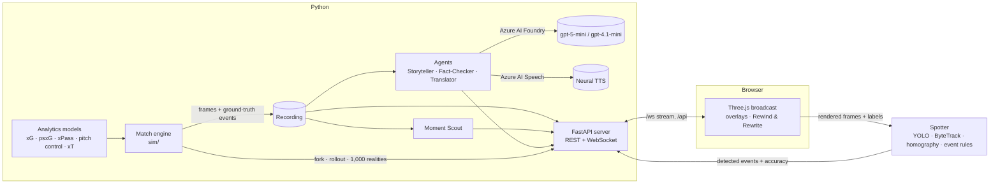

# ReGolazo

> **Every fan has yelled at the screen. Now the screen answers back.**

ReGolazo is an AI broadcast crew for synthetic football matches. A simulated match plays in a stylized 3D broadcast. A vision model watches the rendered feed and logs the events. Agents explain the match in the viewer's language and style. The signature feature is **Rewind & Rewrite**: pause at a decision moment, make a different call, and watch that alternate reality play out. Outcomes come from football analytics models trained on real public data (xG, post-shot xG, pass completion, pitch control, expected threat), never from an LLM.

Built for the Premier League × Microsoft **"Inside the Game"** hackathon.

<!-- DEMO VIDEO LINK GOES HERE -->

## What it does

| Category requirement | How ReGolazo does it |
|---|---|
| **Synthetic dataset creation** | A full 90-minute match engine (`sim/`): 3D ball physics (drag, bounce, spin), player kinematics, tactics, and execution noise scaled by player attributes. Every frame is recorded with ground-truth events using a StatsBomb-style taxonomy (`docs/event_taxonomy.md`). Over 200 simulated matches it lands inside real-football bands for shots, pass completion, passes, headers, shot distance, distance covered and possession spread (`docs/sim_realism.md`). |
| **Auto-eventing from a video feed** | The **Spotter** (`vision/`) watches the rendered broadcast pixels and produces events on its own. It runs a YOLO11n detector fine-tuned on renderer-labelled frames, ByteTrack tracking, team assignment from kit colour, a homography from the broadcast camera calibration, and rule-based event inference. On a held-out match it is scored against simulator ground truth, and a live accuracy panel shows the scores (`docs/vision.md`). |
| **Ingest → interpret → explain → render → personalize** | Engine and Spotter (ingest) → analytics models and Moment Scout (interpret) → Storyteller and Fact-Checker agents (explain) → Three.js broadcast renderer with overlays (render) → mode, language and voice per viewer (personalize). |
| **Player name tags, speed and distance badges** | Overlays on the ball carrier and key players, with sprint and top-speed badges at the taxonomy's thresholds. |
| **Pass distance, accuracy, difficulty; ball and shot speed** | Pass cards (distance, difficulty from xPass) and shot cards (xG, shot speed). |
| **Narratives, milestones, recaps** | Agent-written commentary for every key moment, plus half-time and full-time recaps. |
| **Explainability** | Rewind shows the options the player had, the pitch-control map, and model probabilities adjusted for that player. The verdict compares the fan's choice with reality, and **"Run 1,000 realities"** shows the outcome distribution. |
| **Multi-language output** | English, Spanish and French, each in analyst and casual modes, with Azure neural voices. The language list is configuration. |

### Rewind & Rewrite

The **Moment Scout** (`sim/scout.py`) flags about 10 rewind opportunities per match using objective signals only: how many viable options the carrier had, what was at stake (expected threat, score, minute), what happened next, and whether it's the kind of moment broadcasters replay. It never flags a moment because a player "chose wrong"; that's the fan's call.

At a flagged moment, or any moment the fan pauses on:
- play freezes and the camera swings to tactical;
- the fan picks a teammate or a spot in the goal;
- the engine forks from that exact frame and plays the new reality forward, with the real play ghosted alongside;
- probabilities stay hidden until the fan commits.

The 1,000-reality distribution and the single replay come from the same engine, and a test checks that they agree statistically.

### The Spotter, measured honestly

It's scored on the held-out demo match, which it never trained on, over 178 s of broadcast; an event counts as a match within 1 s.

| | Precision | Recall | F1 |
|---|---|---|---|
| Passes | 0.55 | 0.55 | 0.55 |
| Sprints (> 25.2 km/h) | 0.80 | 0.48 | 0.60 |
| Possession changes | 0.50 | 0.33 | 0.40 |
| Shots (3 in the window) | 1.00 | 0.33 | 0.50 |

- **Detector:** person AP50 is 0.99 and ball AP50 is 0.63.
- **Speed error:** player speed MAE is 1.0 km/h, and ground-ball speed MAE is 2.4 km/h.
- **What doesn't work well yet:**
  - Ball height isn't estimated yet, so lofted-ball speeds are unreliable; captions hide speeds above 120 km/h.
  - Tracking has frequent ID switches.
- **Two better variants** (higher inference resolution; 9 more minutes of training) improve most numbers. For example, pass F1 rises to 0.66 and ball AP50 to 0.67. Both lose the one detected shot to a team-colour error, and choosing between them on the test match would bias the scores, so they're documented but not shipped.

### The agents

All built on **Microsoft Agent Framework**, with models on **Azure AI Foundry**:

- **Storyteller** (`gpt-5-mini`): writes commentary for each moment from a fact sheet built by deterministic tools.
- **Fact-Checker:** verifies every number and name against that fact sheet, with a bounded revise loop. In an injected-falsehood evaluation it caught 137 of 138 false claims and passed 16 of 16 true narratives (`docs/agents.md`).
- **Translator** (`gpt-4.1-mini`): Spanish and French, preserving names and numbers; the translations are fact-checked too.
- **Voice:** Azure AI Speech neural voices: en-GB-RyanNeural, es-ES-AlvaroNeural, fr-FR-HenriNeural.

**Rule:** the LLMs never invent numbers. Every number in every narrative is traceable to a tool output, and a test checks this.

## Microsoft technologies

- **Azure AI Foundry / Azure OpenAI:** `gpt-5-mini` and `gpt-4.1-mini` deployments.
- **Microsoft Agent Framework (Python):** agent orchestration and tool calling.
- **Azure AI Speech:** neural text-to-speech in three languages.

## Architecture



All components share frozen, versioned contracts in `shared/schemas/` (Pydantic → JSON Schema → TypeScript). The details are in [docs/ARCHITECTURE.md](docs/ARCHITECTURE.md).

## Quickstart

You need Python 3.12 with [uv](https://docs.astral.sh/uv/), Node 20+, and ffmpeg.

```bash
uv sync
cd web && npm ci && cd ..

# 1. Simulate the demo match (about 2 minutes; writes data/matches/candidate-2004/)
uv run python scripts/sim_match.py --seed 2004 --match-id candidate-2004

# 2. Flag rewind moments
uv run python -m sim.scout --match candidate-2004

# 3. (optional, needs Azure keys in .env, see .env.example) precompute narration and voice
uv run python -m agents.precompute --match candidate-2004

# 4. Serve it with the live engine
REGOLAZO_ENGINE=sim.engine:create_engine uv run python -m server --match candidate-2004

# 5. In another terminal: the web app (vite proxies /api and /ws to the server, so no CORS setup is needed)
cd web && REGOLAZO_API=http://127.0.0.1:8000 npm run dev
# open http://localhost:5173/?live=1          (add &t=4448 to start just before the 74' rewind moment)
```

The server listens on port 8000 by default; change it with `REGOLAZO_PORT` or `--port`, and change the web port with `npm run dev -- --port <n>`. If you connect the page directly to the server with `?ws=ws://host:port/ws`, instead of through the proxy, add the page's origin to `REGOLAZO_CORS_ORIGINS`.

Without Azure keys, everything except narration works.

The **Spotter's** weights and training renders live under `data/` and aren't committed. To rebuild them, render the dataset with `scripts/spotter_dataset.py`, train with `scripts/spotter_train.py`, then run `scripts/spotter_run.py offline` or `scripts/spotter_demo.py`. Training takes about 25 minutes on an M3 Pro. The full steps are in [docs/vision.md](docs/vision.md).

### Checks

```bash
uv run ruff check . && uv run ruff format --check . && uv run mypy . && uv run pytest -m "not live"
cd web && npm run lint && npm run typecheck && npm test
```

## Known limitations

- **Simulator realism:** over 200 matches goals average 3.12 per match, just above the 3.08 upper band, and one rare event (a successful offside trap) never occurs. Every other realism band passes.
- **Expected-goals edge cases:** the xG model is weak on empty-net long shots, so shots are resolved with post-shot xG. The pass model is weaker on crosses and through balls than on ground passes.
- **Narration is precomputed** for the recorded match, because a live Storyteller call takes 7–11 s. Rewind verdicts are not narrated yet.
- **Not deployed:** Azure Container Apps deployment (planned Step 11) was cut for time, and the app runs locally.

## Data, models and licences

- **StatsBomb Open Data** trains and calibrates xG, post-shot xG, xPass and the realism targets. © StatsBomb, used under the [StatsBomb Open Data licence](https://github.com/statsbomb/open-data/blob/master/LICENSE.pdf); thanks to StatsBomb for making it public.
- **Metrica Sports sample tracking data** gives the physical priors and the distance-covered targets. © Metrica Sports, [sample-data](https://github.com/metrica-sports/sample-data), used under its licence.
- **Ultralytics YOLO** is used by the Spotter and is licensed **AGPL-3.0**. The Spotter, and any distribution that includes it, is subject to AGPL-3.0.
- **Mixamo** (Adobe) provides the athlete rig and animation clips. Only processed in-app assets are shipped; raw Mixamo files are not redistributed.
- **Barlow Condensed** font: SIL Open Font License (`web/public/fonts/OFL.txt`).
- Pitch control follows Spearman (2018). Expected threat follows Karun Singh (2018).
- Everything shown on screen is synthetic: fictional clubs, players and kits, with no real likenesses, crests or sponsors.

ReGolazo's own code is released under the [MIT licence](LICENSE).
