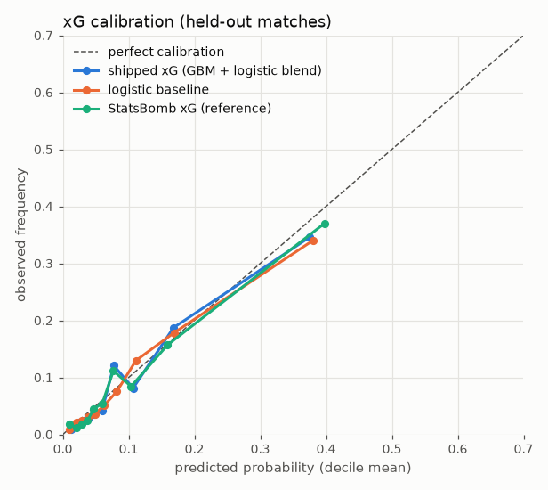
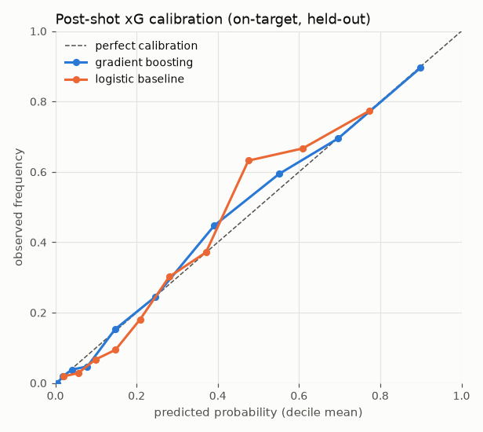
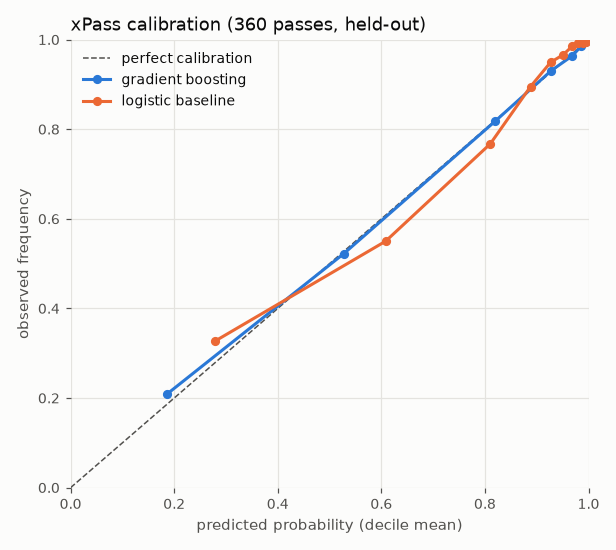
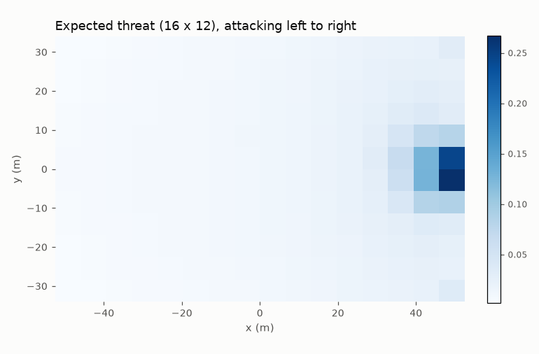

# ReGolazo analytics models: evaluation report

We trained these models on real public football data (StatsBomb Open Data and Metrica Sports sample tracking). Everything shown on screen runs on synthetic matches; the real data is used only for training and calibration (PLAN.md §3). The simulator and agents load the models through `shared.model_api.load_models()`, which returns `analytics.models.TrainedModels` once `analytics/artifacts/manifest.json` exists.

All numbers below come from `analytics/artifacts/metrics.json`, written by `python -m analytics.train`. Unless a row says otherwise, metrics are on **held-out matches**: 20 % of matches go to the test set (seed 7, grouped by match, so no match appears on both sides). After evaluation, each shipped model is refit on all rows with the same number of trees.

## 1. Data

| Source | What we used | Volume |
|---|---|---|
| StatsBomb Open Data (events, lineups, 360) | Men's: UEFA Euro 2020 and 2024, FIFA World Cup 2018 and 2022, Premier League 2015/16, 1. Bundesliga 2023/24 | 644 matches, 16,511 shots, 1.16 M passes and carries |
| StatsBomb 360 freeze frames | Euro 2020, Euro 2024, World Cup 2022, Bundesliga 2023/24 | 200 matches, 175,099 passes with a freeze frame |
| Metrica Sports sample data | Sample games 1 and 2 (25 Hz tracking + events, anonymised) | 2 matches, 50 outfield player-games |

Reproduce:

```bash
export REGOLAZO_DATA_DIR=/path/to/shared/data      # default <repo>/data; raw files land in $REGOLAZO_DATA_DIR/raw/
uv run python scripts/download_statsbomb.py         # ~3.3 GB, about 1 minute
uv run python scripts/download_metrica.py           # ~160 MB
uv run python -m analytics.build_dataset            # feature tables -> $REGOLAZO_DATA_DIR/cache/analytics/*.npz (10 s)
uv run python -m analytics.train                    # train, evaluate, export artifacts, plots, golden vectors (~40 s)
```

Coordinates: StatsBomb's 120 × 80 yd frame always has the acting team attacking +x. `shared.geometry.statsbomb_to_attacking_frame` and `statsbomb_goal_plane` convert it to the metric attacking frame (105 × 68 m, centre origin). 360 freeze frames use the same frame as their event. Freeze-frame geometry (shot cone, nearest defender, passing lane) is computed by `analytics/features.py`. The same code builds features for simulator scenes (`analytics/scene.py`), so the training data and the simulator describe a situation the same way.

## 2. xG (pre-shot)

**Features** (`ShotFeatures` → `analytics.design.xg_matrix`): distance and angle to goal, |y|, body part (foot / head / other), technique (chip, volley, half-volley, diving header, backheel, overhead; StatsBomb "Normal" is `placed`, or `header` for headed shots), situation (open play, counter, set piece = shot ≤ 10 s after a corner / free kick / throw-in restart as in taxonomy §3.5.2, direct free kick), keeper distance off the line, keeper distance to the shooter, keeper's lateral offset from the shot line, outfield defenders in the shooter–post–post triangle, nearest outfield defender, under pressure, first time.

**Model:** we ship the mean of the logits of two models: a gradient-boosted model (scikit-learn `HistGradientBoostingClassifier`, 212 trees, monotone in distance, angle and defenders in cone) and a logistic regression (the same features plus log distance and header × distance, which handles headers through an interaction). On repeated splits the blend beat both models on their own. **Penalties** use the empirical conversion rate, **0.772** (180 penalties), instead of the model.

| Held-out (3,315 non-penalty shots, 297 goals) | AUC | Log-loss | Brier | Mean pred / base rate |
|---|---|---|---|---|
| **Shipped xG (blend)** | **0.798** | **0.249** | **0.0701** | 0.094 / 0.090 |
| Gradient boosting only | 0.788 | 0.252 | 0.0708 | 0.095 |
| Logistic baseline | 0.798 | 0.250 | 0.0705 | 0.095 |
| StatsBomb's own xG on the same shots (reference) | 0.803 | 0.245 | 0.0684 | 0.094 |
| Shipped xG, foot shots (2,770) | 0.815 | 0.239 | 0.0672 | |
| Shipped xG, headers (545) | 0.699 | 0.299 | 0.0846 | (StatsBomb xG: 0.706) |

On five other match splits, mean AUC is 0.791 for the shipped blend (range 0.782–0.802), against 0.785 for GBM alone, 0.789 for the logistic and 0.795 for StatsBomb xG. Mean log-loss is 0.261, against 0.258 for StatsBomb. This falls within the published 0.78–0.82 range and within about 0.005 AUC of StatsBomb's commercial model. StatsBomb's model also sees inputs we don't have at inference time, such as assist type and the full freeze-frame body orientation.



Calibration (decile mean predicted → observed): 0.013→0.009, 0.039→0.027, 0.077→0.121, 0.107→0.081, 0.168→0.187, 0.376→0.346. The calibration is good across the range and tracks StatsBomb's curve.

## 3. Post-shot xG / save model

**Data:** on-target shots only (goal, saved, saved to post): 5,354 shots, 31.0 % goals. We project the StatsBomb end location onto the goal plane. Saved shots end where the keeper touched the ball, so we extrapolate y along the shot line to the goal line and scale z by the same ratio.

We found and fixed a leak here. Goals are recorded on StatsBomb's 0.1-yard lattice and projected saves are not, so a tree model separated them by quantisation alone (AUC 0.98 on placement). Projections are now snapped back to the lattice, and placement alone scores AUC 0.75.

**Features** (`PostShotFeatures`): |end y|, end z, shot distance, keeper distance off the line, keeper distance to the crossing point, keeper lateral distance to it. The gradient-boosted model is monotone in |end y| and in the keeper-to-ball distances.

**Ball speed is a prior, not learned.** The StatsBomb speed proxy (distance ÷ event duration) is *anti*-correlated with goals: the goal rate is 50 % at 5–15 m/s, 38 % at 15–22, 15 % at 22–30 and 5 % at 30–40 m/s. That is how durations are recorded, not physics. The shipped `psxg` therefore adds +0.06 logit per m/s above a 22 m/s (80 km/h) reference. **Keeper rating** is a second prior: −0.01 logit per point of `gk_dive` above 50, about −0.4 logit for a 90-rated keeper, in line with the spread of real keepers' PSxG − goals allowed. Both coefficients are in `manifest.json`. The simulator team can retune them in its consistency test.

| Held-out (1,056 on-target shots) | AUC | Log-loss | Brier |
|---|---|---|---|
| **Learned post-shot model (GBM, 181 trees)** | **0.896** | **0.375** | **0.121** |
| Shipped with speed prior, evaluated on the StatsBomb speed proxy | 0.867 | 0.421 | 0.139 |
| Logistic baseline | 0.853 | 0.443 | 0.145 |
| Pre-shot StatsBomb xG on the same shots (what the ball state adds) | 0.786 | 0.603 | 0.191 |

The second row is pessimistic: it feeds the unreliable proxy into the prior. The simulator gives the true speed at the goal plane.



Calibration of the learned model: 0.019→0.019, 0.079→0.047, 0.246→0.245, 0.391→0.448, 0.551→0.594, 0.697→0.695, 0.900→0.896.

## 4. xPass (pass completion)

**Data:** 175,099 passes with a 360 freeze frame (throw-ins and kick-offs excluded; outcomes "Unknown" and "Injury Clearance" dropped; out, incomplete and offside count as failures). Completion rate is 84.2 %.

**Features** (`PassFeatures`): origin and destination (x, |y|), length, direction, destination distance to goal, height (ground / low / high), kind, distance from the destination to the nearest opponent (the receiver proxy, keeper included), opponents within 2 m of the passing lane, and under pressure. Kind follows taxonomy precedence: cutback > cross > through ball > switch > chipped (high and ≤ 25 m) > back pass (≥ 135°, ≥ 3 m) > standard. The gradient-boosted model has 219 trees and is monotone in lane defenders and receiver space.

| Held-out (35,248 passes) | AUC | Log-loss | Brier |
|---|---|---|---|
| **Gradient boosting** | **0.941** | **0.214** | **0.066** |
| Logistic baseline | 0.899 | 0.278 | 0.086 |

AUC by kind: standard 0.940 (n 26,294, completion 86 %), back pass 0.931 (98 %), switch 0.935 (74 %), chipped 0.765 (52 %), cutback 0.765 (n 83, 51 %), cross 0.720 (34 %), through ball 0.708 (33 %).



The calibration is very close to the diagonal (0.185→0.208, 0.527→0.522, 0.820→0.818, 0.928→0.931, upper deciles within 0.005).

**Caveat for the simulator:** 360 frames show only the players in the broadcast camera's view (median 9 of 11 opponents). In the simulator all 22 players are known, so lane counts and receiver distances are complete. xPass may therefore be a few points lower in the simulator than for an identical real situation. The consistency test should calibrate against the displayed xPass, not real-world rates.

## 5. Pitch control (Spearman 2018)

`analytics/pitch_control.py` is a vectorised port of the Friends of Tracking reference (Laurie Shaw, LaurieOnTracking `Metrica_PitchControl.py`). It uses that reference's default parameters, which are exactly `shared.model_api.PitchControlParams()`:

- reaction time 0.7 s, maximum speed 5 m/s
- arrival-time σ 0.45 s
- control rate λ 4.3 s⁻¹ for both teams; the defending keeper (the defender nearest the defended goal, within 25 m) gets 3 × λ
- average ball speed 15 m/s
- integration step 0.04 s for up to 10 s, until P(att) + P(def) > 0.99

`TrainedModels.pitch_control` returns P(att) normalised so that P(att) + P(def) = 1.

| Check | Result |
|---|---|
| Agreement with the reference code on a Metrica frame (game 1, 176 grid points, run through the original LaurieOnTracking function) | max abs difference 3e-16 (`analytics/tests/fixtures/metrica_pc_frame.json`) |
| Raw probabilities per cell (672-cell grid) | 0.99 ≤ P(att) + P(def) ≤ 1 everywhere |
| Team-swap symmetry (no keeper bonus) | P_att(A, D) = P_def(D, A) to 1e-12 |
| Mirror symmetry (y → −y) | identical surface to 1e-12 |
| Identical teams | 0.5 everywhere |
| Metrica passes: P(att) at the destination when the pass is struck | Game 1: completed 0.891 vs lost 0.316, AUC 0.963 (799 / 192). Game 2: 0.885 vs 0.341, AUC 0.969 (964 / 160) |
| Speed | 672 points in 13 ms, 1,600 points in 26 ms, 5 points in 0.6 ms (M3 Pro) |

For lost balls, Metrica's end location is often where the ball was lost, so the pass AUC is optimistic. It is a sanity check, not a benchmark.

## 6. Expected threat (xT)

This is Karun Singh's method on a 16 × 12 grid in the attacking frame. For each cell, xT = P(shot)·P(goal | shot) + P(move)·Σ T(z → z′)·xT(z′). Moves are the 1,145,378 StatsBomb passes and carries; T counts successful moves over all moves, so failed moves are worth 0. The 16,331 non-penalty shots give P(goal | shot). We solve it by fixed-point iteration. `xt(x, y)` interpolates bilinearly between cell centres.



Mean xT by column, from own goal to opponent goal: 0.0035, 0.0043, 0.0051, 0.0059, 0.0067, 0.0076, 0.0087, 0.0099, 0.0115, 0.0134, 0.0158, 0.0188, 0.0236, 0.0344, 0.0528, 0.0758. It rises in **15 of 15** steps. The maximum is 0.267, in the cell in front of goal, and central cells are worth several times more than wide ones.

## 7. Physical priors (Metrica)

| Prior | Value | How it is measured |
|---|---|---|
| Top speed | 8.28 ± 0.59 m/s (29.8 km/h) | per outfield player: best 1 s rolling mean of the speed, from positions smoothed over 7 frames (0.28 s); samples above 12 m/s treated as glitches |
| Peak acceleration | 4.37 ± 1.33 m/s² | per player: 99.9th percentile of the speed gain over 0.5 s on 0.5 s-smoothed speed (the raw maximum is dominated by tracking noise) |
| Reaction-time proxy | 0.72 s (IQR 0.45–0.91, 106 passes) | delay from a pass (≥ 10 m, ≥ 0.8 s of flight) being struck until the defender nearest its target accelerates towards it at > 1.5 m/s² |
| Distance covered | 10,357 ± 685 m per outfield player per match (30 players with ≥ 85 min) | sum of smoothed speed × dt |

The reaction-time proxy includes the time needed to read the pass, so it agrees with Spearman's 0.7 s rather than the ~0.25 s of a pure reflex. The stub's 0.25 s is replaced by the measured 0.72 s in `physical_priors.reaction_time_s`. The simulator should treat it as the model's "decision + reaction" time.

## 8. Realism targets (`analytics/artifacts/realism_targets.json`)

These are for the simulator realism test (PLAN.md Step 3). StatsBomb men's matches, regulation time only (periods 1–2):

- Passes exclude throw-ins.
- Completion uses StatsBomb's convention: a pass with no outcome counts as completed.
- Distance covered comes from Metrica.

`band` is a suggested tolerance for the simulator's mean over at least 200 matches.

| Stat | Mean | Std (per match / team) | Band |
|---|---|---|---|
| Goals per match | 2.68 | 1.66 | 2.27–3.08 (±15 %) |
| Shots per team | 12.6 | 5.5 | 10.7–14.5 (±15 %) |
| Pass completion | 79.0 % (pooled) | 7.4 | 75.1–83.0 (±5 %) |
| Passes per team | 477 | 127 | 405–548 (±15 %) |
| Header share of shots | 0.167 (pooled) | 0.135 | 0.125–0.209 (±25 %) |
| Mean shot distance | 16.4 m (pooled) | 2.6 | 14.8–18.1 (±10 %) |
| Possession split (team share of passes) | 50 % | 11.6 | sim std in 8.1–15.1 |
| Distance per outfield player | 10,357 m | 685 | 9,321–11,393 (±10 %) |

The file also has per-competition means. For example, Premier League 2015/16 has 2.70 goals per match, 13.0 shots and 462 passes per team, and 76.4 % completion.

## 9. Artifacts and inference

`analytics/artifacts/` (about 280 KB in total, committed):

| File | Contents |
|---|---|
| `manifest.json` | model versions, file map, penalty xG, post-shot priors, pitch-control parameters, headline metrics |
| `xg_gbm.npz`, `psxg_gbm.npz`, `xpass_gbm.npz` | tree ensembles flattened to node arrays |
| `xg_logistic.json` | the logistic half of the xG blend |
| `xt_grid.json` | the 16 × 12 xT grid |
| `physical_priors.json` | the Metrica priors |
| `realism_targets.json` | the simulator realism targets |
| `metrics.json` | every number in this report |

Inference needs only numpy. `analytics/trees.py` evaluates the exported ensembles: 1,000 shots in about 40 ms, 1,000 passes in about 20 ms. Golden vectors in `analytics/tests/fixtures/` pin it to the scikit-learn outputs at training time (≤ 1e-5). scikit-learn and matplotlib are dev dependencies used only for training.

`analytics/scene.py` turns a `SimState` into a team's attacking-frame `Scene` and provides:

- `shot_features(scene, shooter_xy, ...)`
- `pass_features(scene, passer_xy, targets, ...)`
- `pitch_control_grid(models, scene)`, which returns a world-frame `PitchControlGrid`

The simulator does not have to reimplement the freeze-frame geometry.

## 10. Data licences and attribution (for the README)

- **StatsBomb Open Data.** © StatsBomb, from https://github.com/statsbomb/open-data under the StatsBomb Public Data User Agreement (`LICENSE.pdf` in that repository). The terms require that anything published from the data states StatsBomb as the source and uses the StatsBomb logo from their media pack. Suggested README line: *"Event and 360 data provided by StatsBomb (StatsBomb Open Data)."*, plus the logo.
- **Metrica Sports sample data.** From https://github.com/metrica-sports/sample-data, anonymised tracking and event data. The repository asks users to "be responsible with the use of this data" and to acknowledge the source in anything public. There is no separate licence file. Suggested README line: *"Tracking data: Metrica Sports sample data."*
- **Pitch-control reference.** The implementation follows William Spearman, "Beyond Expected Goals" (MIT Sloan Sports Analytics Conference, 2018), and Laurie Shaw's Friends of Tracking code (https://github.com/Friends-of-Tracking-Data-FoTD/LaurieOnTracking). We used that code only to produce the reference numbers in the test fixture; none of it is vendored.
- **xT.** Karun Singh, "Introducing Expected Threat (xT)" (2018).

## 11. Known limitations

- Header xG is weaker (AUC 0.70) than foot xG (0.81), as it is for StatsBomb's own model (0.71). Without cross or assist type there is little to separate headers.
- StatsBomb has no placed / driven / finesse split, so these share the "placed" baseline in xG. The difference shows up through execution and the post-shot model.
- The post-shot speed and keeper-rating effects are priors, not fitted (§3).
- xPass is trained on partially visible 360 frames (§4).
- The physical priors come from two anonymised matches (50 player-games). The reaction time is a proxy, not a direct measurement.
